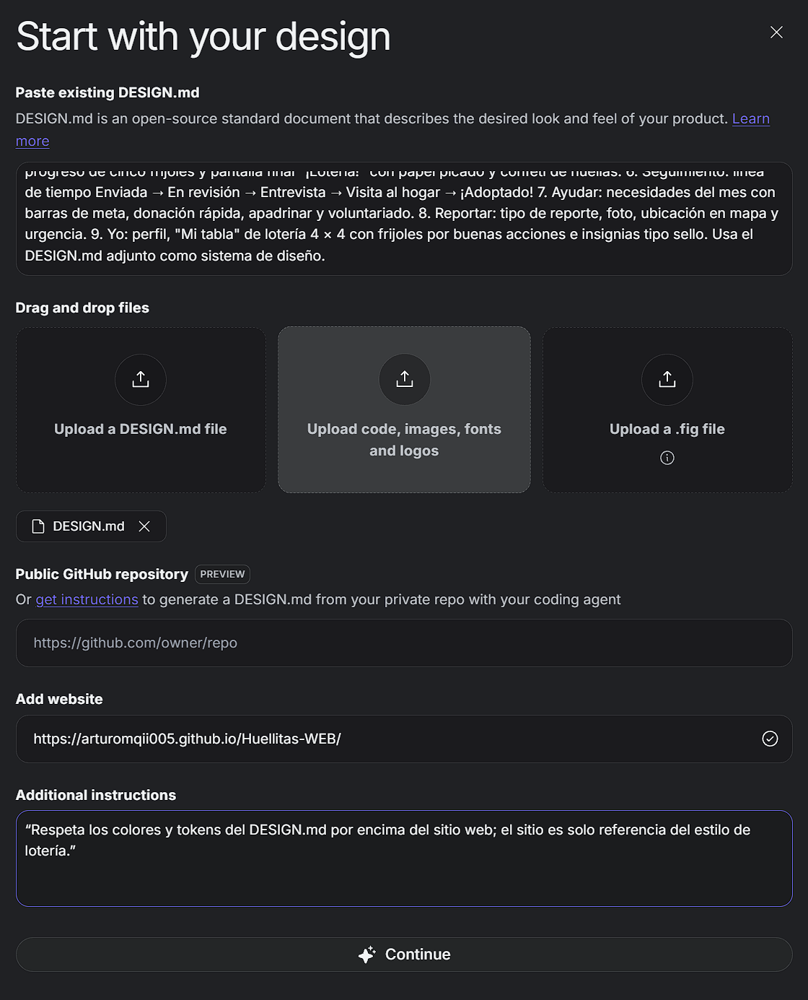
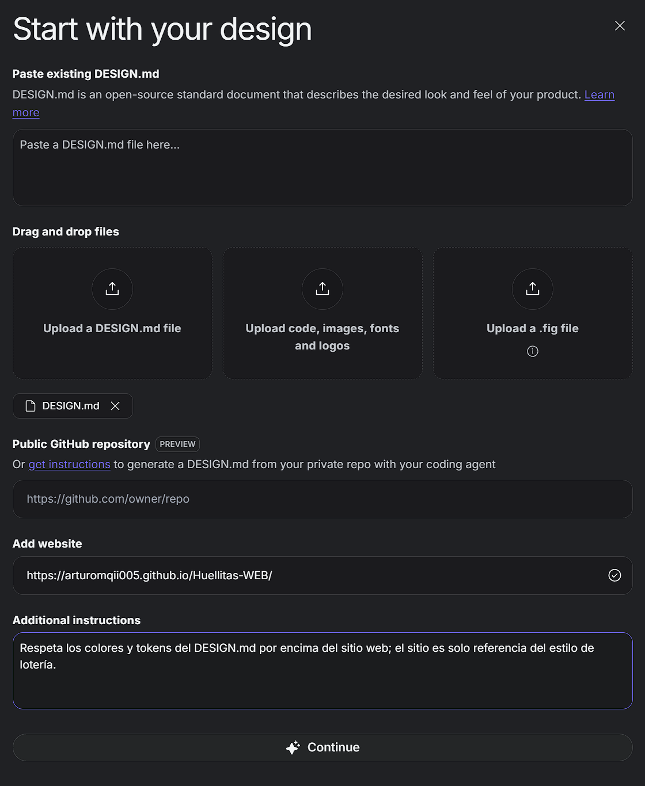
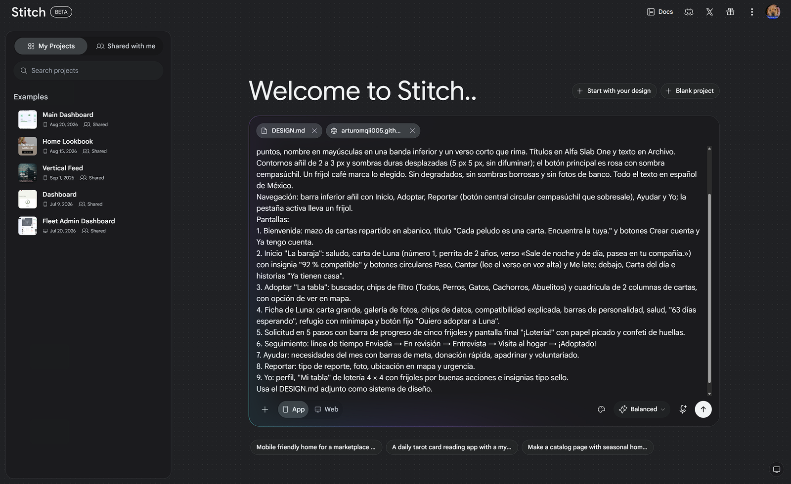
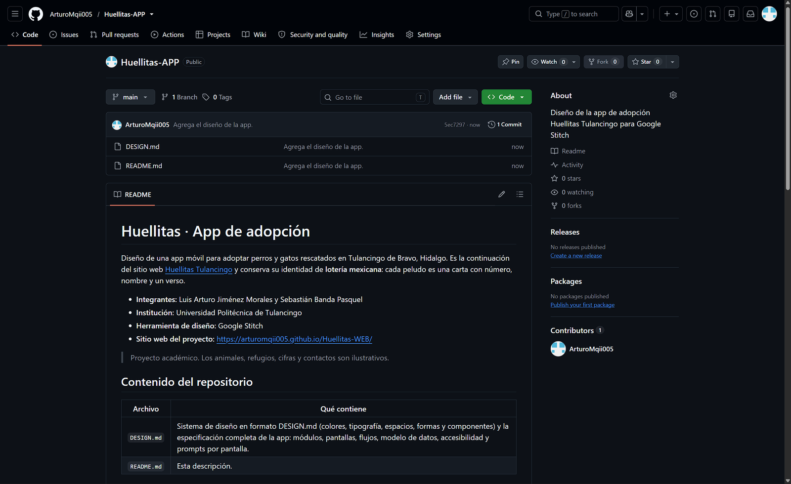

# Evidencias del uso de IA · Huellitas

Registro de cómo se usó la inteligencia artificial generativa para diseñar la propuesta de la aplicación web **Huellitas**: qué herramientas se usaron, con qué prompts y qué se modificó para mejorar la propuesta inicial.

## Herramientas utilizadas

| Herramienta | Para qué se usó |
| --- | --- |
| **Claude** (Anthropic) | Analizar el problema, redactar el DESIGN.md, escribir los prompts para Stitch y revisar la propuesta contra los requisitos de la actividad. |
| **Google Stitch** | Generar las interfaces de la aplicación a partir del DESIGN.md, del sitio web del proyecto y de los prompts. |
| **Verificador oficial de DESIGN.md** (`@google/design.md`) | Validar la estructura del archivo y el contraste de los colores (WCAG AA). |

## Resumen del proceso

| Iteración | Qué se hizo | Resultado |
| --- | --- | --- |
| 1 | Se pidió a Claude el prompt y la especificación de la aplicación | DESIGN.md v1 con sistema de diseño, 14 módulos y prompts |
| 2 | Primera generación en Google Stitch | Pantallas del adoptante en versión de celular |
| 3 | Revisión de la propuesta contra los requisitos de la actividad | DESIGN.md v2: aplicación web responsiva, 4 roles, acceso, panel del refugio y administración |
| 4 | Generación de las interfaces por rol en Stitch | Pantallas web y de celular para visitante, adoptante, refugio y administrador (en proceso) |

---

## Iteración 1 · Especificación inicial con Claude

**Prompt principal (resumido):**

> Necesito un prompt para realizar una aplicación sobre el mismo problema de Huellitas. Primero dame el prompt y después un archivo .md muy bien estructurado con cómo va a quedar la aplicación y los módulos que tendrá. Que se vea increíble.

**Lo que hizo la IA**

- Investigó el formato abierto DESIGN.md que usa Google Stitch (tokens en YAML y secciones en Markdown).
- Retomó la identidad del sitio web del proyecto (lotería mexicana, tres tintas, Alfa Slab One y Archivo).
- Redactó el DESIGN.md con colores, tipografía, espacios, formas, 36 componentes, 14 módulos, flujos, modelo de datos y prompts por pantalla.
- Validó el archivo con el verificador oficial: **0 errores y 0 advertencias**.

---

## Iteración 2 · Primera generación en Google Stitch

### Configuración

Se usó la opción **Start with your design** de Stitch:

- **DESIGN.md:** el archivo de la iteración 1.
- **Sitio web de referencia:** `https://arturomqii005.github.io/Huellitas-WEB/`
- **Instrucción adicional:** «Respeta los colores y tokens del DESIGN.md por encima del sitio web; el sitio es solo referencia del estilo de lotería.»

**Ajuste realizado:** en el primer intento el prompt se pegó en el cuadro reservado para el DESIGN.md y la instrucción adicional llevaba comillas. Se dejó vacío ese cuadro (el DESIGN.md ya estaba subido como archivo), se quitaron las comillas y el prompt se escribió en la pantalla principal.

| Antes | Después |
| --- | --- |
|  |  |

### Prompt inicial

Modo **App** (celular), con el DESIGN.md y el sitio web adjuntos:



```
Diseña "Huellitas", una app móvil (iOS y Android, 390 × 844) para adoptar perros y gatos rescatados en Tulancingo, Hidalgo. Hoy los animales se anuncian en grupos de Facebook y los avisos se pierden en horas; la app reúne a los peludos de varios refugios, guía la adopción paso a paso y conecta a quien quiere ayudar con lo que falta cada mes.

Estilo: lotería mexicana impresa en serigrafía de tres tintas: añil #1F2A6B, rosa mexicano #D6006F y cempasúchil #FFB30F sobre papel crema #FFFBF2. Cada peludo es una carta de lotería con número en la esquina, ilustración plana con trama de puntos, nombre en mayúsculas en una banda inferior y un verso corto que rima. Títulos en Alfa Slab One y texto en Archivo. Contornos añil de 2 a 3 px y sombras duras desplazadas (5 px 5 px, sin difuminar); el botón principal es rosa con sombra cempasúchil. Un frijol café marca lo elegido. Sin degradados, sin sombras borrosas y sin fotos de banco. Todo el texto en español de México.

Navegación: barra inferior añil con Inicio, Adoptar, Reportar (botón central circular cempasúchil que sobresale), Ayudar y Yo; la pestaña activa lleva un frijol.

Pantallas:
1. Bienvenida: mazo de cartas repartido en abanico, título "Cada peludo es una carta. Encuentra la tuya." y botones Crear cuenta y Ya tengo cuenta.
2. Inicio "La baraja": saludo, carta de Luna (número 1, perrita de 2 años, verso «Sale de noche y de día, pasea en tu compañía.») con insignia "92 % compatible" y botones circulares Paso, Cantar (lee el verso en voz alta) y Me late; debajo, Carta del día e historias "Ya tienen casa".
3. Adoptar "La tabla": buscador, chips de filtro (Todos, Perros, Gatos, Cachorros, Abuelitos) y cuadrícula de 2 columnas de cartas, con opción de ver en mapa.
4. Ficha de Luna: carta grande, galería de fotos, chips de datos, compatibilidad explicada, barras de personalidad, salud, "63 días esperando", refugio con minimapa y botón fijo "Quiero adoptar a Luna".
5. Solicitud en 5 pasos con barra de progreso de cinco frijoles y pantalla final "¡Lotería!" con papel picado y confeti de huellas.
6. Seguimiento: línea de tiempo Enviada → En revisión → Entrevista → Visita al hogar → ¡Adoptado!
7. Ayudar: necesidades del mes con barras de meta, donación rápida, apadrinar y voluntariado.
8. Reportar: tipo de reporte, foto, ubicación en mapa y urgencia.
9. Yo: perfil, "Mi tabla" de lotería 4 × 4 con frijoles por buenas acciones e insignias tipo sello.

Usa el DESIGN.md adjunto como sistema de diseño.
```

---

## Iteración 3 · Revisión contra los requisitos de la actividad

**Prompt principal (resumido):**

> Revisa que lo que hiciste tenga todas las especificaciones que pide mi profesor. *(Se adjuntaron las instrucciones, los entregables y los criterios de evaluación de la actividad.)*

**Hallazgos y modificaciones**

| Lo que faltaba en la propuesta inicial | Modificación realizada |
| --- | --- |
| Se diseñó como app móvil, pero la actividad pide una **aplicación web** | Se convirtió en aplicación web responsiva (mobile first) con lienzos de computadora (1440 px) y celular (390 px), puntos de quiebre y navegación para cada tamaño |
| No había roles con funciones, permisos y restricciones | Se definieron **4 roles** (visitante, adoptante, refugio y administrador), cada uno con funciones, permisos y restricciones, más una matriz de permisos y reglas de acceso y seguridad |
| No había pantalla de acceso al sistema | Se agregó el módulo **Inicio público y acceso**: portada, entrar, crear cuenta, recuperar contraseña y registrar refugio, con redirección según el rol |
| Todas las pantallas eran del adoptante | Se agregaron el **Panel del refugio** y la **Administración**, con menús laterales propios, tablas, formularios, tablero de solicitudes y bitácora |
| La interfaz no cambiaba según el rol | Se documentó **la misma pantalla según el rol** (encabezado, ficha del peludo, Ayudar y Reportes) |
| El objetivo no estaba escrito de forma explícita | Se agregaron el objetivo general y cinco objetivos específicos |
| Los lineamientos UX/UI y las reglas estaban dispersos | Se crearon las secciones **Lineamientos UX/UI** (11 lineamientos) y **Reglas del sistema** (adopción, publicación, privacidad y registro de actividad) |
| Faltaban componentes para web y paneles | Se agregaron barra superior web, menús laterales del refugio y del administrador, tarjeta de acceso, etiquetas de rol y tablas (46 componentes en total) |
| Los prompts solo generaban pantallas del adoptante | Se escribieron 22 prompts organizados por rol (P1 a P22), indicando si cada pantalla va en modo Web o celular |

El DESIGN.md v2 se volvió a validar con el verificador oficial: **0 errores y 0 advertencias**.

---

## Iteración 4 · Interfaces por rol en Google Stitch

Con el DESIGN.md v2 se generan las pantallas que faltan, usando los prompts de la sección **Prompts por pantalla** del DESIGN.md:

| Rol | Prompts | Modo |
| --- | --- | --- |
| Visitante | P1 Portada pública · P2 Entrar · P3 Registrar mi refugio | Web y celular |
| Adoptante | P5 Inicio (también en celular) · P7 La tabla · P8 Ficha · P10 Mis solicitudes · P11 Ayudar | Web |
| Adoptante | P4 Perfil de hogar · P6 Deslizando · P9 Solicitud · P12 Reportar · P13 Mi tabla | Celular |
| Refugio | P14 Resumen · P15 Peludos y generador de cartas · P16 Tablero de solicitudes · P21 Panel en celular | Web y celular |
| Administrador | P17 Verificación de refugios · P18 Usuarios y roles · P19 Bitácora | Web |
| Estados especiales | P20 Acceso denegado (web) · P22 Noche de lotería (celular) | Web y celular |

### Prompts de corrección para Stitch

Cuando una pantalla generada no respeta el diseño, se corrige con prompts cortos como estos:

- «Quita los degradados y las sombras difuminadas. Usa sombras duras de 5 px en añil #1F2A6B, sin desenfoque.»
- «Usa solo la paleta del DESIGN.md: añil, rosa mexicano, cempasúchil y papel crema.»
- «Muestra a cada peludo como carta de lotería: número en la esquina, ilustración y nombre en mayúsculas en una banda inferior.»
- «Cambia todos los textos al español de México.»
- «Deja un solo botón rosa en la pantalla; los demás deben ser secundarios.»
- «Agrega la etiqueta cempasúchil "Refugio" junto al nombre en el menú lateral.»

### Registro de ajustes en Stitch

Cada corrección que se pida en Stitch se anota aquí, con su captura de antes y después.

| Pantalla | Problema en la primera versión | Prompt de corrección | Resultado |
| --- | --- | --- | --- |
| | | | |

---

## Publicación

- **Repositorio:** https://github.com/ArturoMqii005/Huellitas-APP


